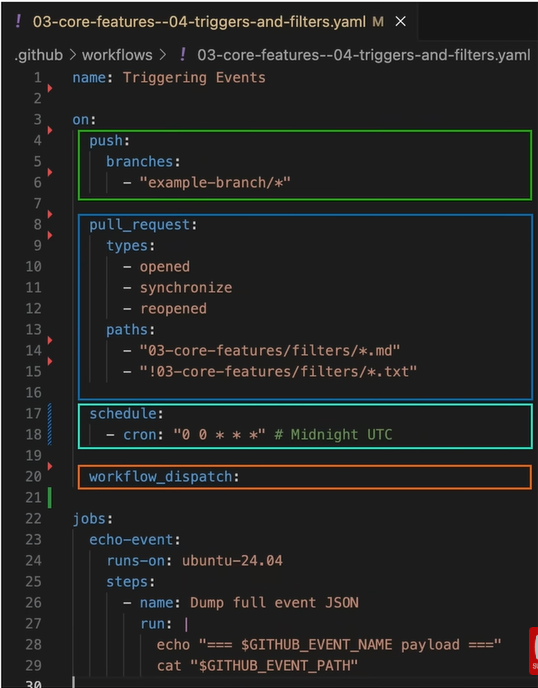

# GitHub Actions

## Common Workflow Types

| Type | Purpose | Examples |
|------|---------|----------|
| **Validate** | Check code quality before merging | Tests, linting, static analysis (security, code quality) |
| **Build** | Produce deployable artifacts | Executables, container images |
| **Deploy** | Ship to an environment | Push-based deploys, updated tags for GitOps deploys |

## Example workflow

## Triggering Events

Almost any github event can trigger a workflow:
* Trigger manually
* Push to branch
* Create/update pull request
* Cron jobs
* Many more

